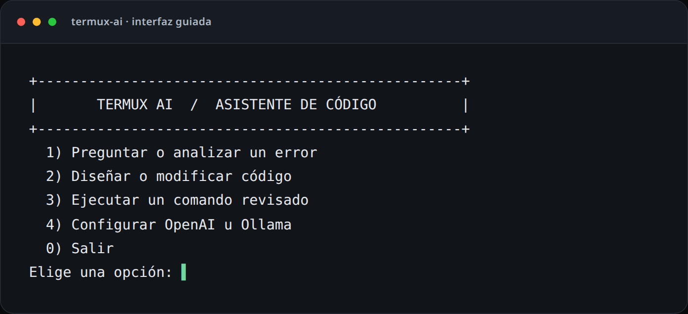

# Termux AI Code Assistant

Asistente de programación para Termux. Permite hacer preguntas, analizar errores, proponer cambios de código revisables y ejecutar comandos que tú escribes, siempre con confirmación antes de modificar archivos o ejecutar un comando.



*Vista del menú interactivo capturada desde la CLI. El menú se abre ejecutando `termux-ai` sin argumentos.*

## Funciones principales

- **Interfaz guiada** para preguntas, diseño de cambios, ejecución de comandos y configuración del proveedor.
- **OpenAI, Ollama y endpoints compatibles** con la API Chat Completions de OpenAI.
- **Descubrimiento de modelos** en el servidor, cuando el endpoint ofrece `GET /models`, con entrada manual como alternativa.
- **Enrutamiento por tarea:** conversaciones generales usan el modelo general; solicitudes de código, depuración o preguntas con archivos adjuntos pueden usar un modelo de código distinto.
- **Cambios revisables:** se muestran como diff y solo se escriben después de que confirmes.
- **Ejecución explícita:** los comandos los introduces tú y se confirman antes de ejecutarse.
- **Instalación ligera en Android:** usa módulos incluidos en Python; no instala el SDK `openai`, `jiter`, `maturin` ni requiere Rust.

## Requisitos

- Android con Termux y Bash.
- Python 3.10 o posterior, instalado desde los paquetes de Termux.
- Un endpoint compatible con `POST /chat/completions`: OpenAI, Ollama en un equipo accesible por red o un proveedor compatible.
- Conexión a Internet para OpenAI, o conectividad de red entre el teléfono y el servidor elegido.

> Para Ollama, el servidor normalmente se ejecuta en una computadora de la red. Este proyecto instala la CLI en Termux; no instala ni presupone que Ollama pueda ejecutarse localmente en el teléfono.

## Instalación

### Instalación nueva

En Termux, desde el directorio donde quieres guardar el repositorio:

```bash
pkg update
pkg install -y git python
git clone https://github.com/hubgunter4-ops/termux-ai-agent.git
cd termux-ai-agent
chmod +x install.sh
./install.sh
source ~/.bashrc
```

Abre la configuración interactiva:

```bash
termux-ai configure
```

O inicia el menú principal con `termux-ai`; también puedes escribir `termux-ai wizard`.

El instalador instala el paquete `python` de Termux, copia la CLI a `~/.termux-agent/` y añade el cargador de comandos a `~/.bashrc` si aún no existe. **No usa pip para instalar clientes de API.** Las llamadas HTTP y el listado de modelos usan la biblioteca estándar de Python, lo que evita el error de compilación de `jiter`/`maturin` que puede ocurrir en Android ARM64.

### Actualizar una instalación existente

Desde el clon del repositorio:

```bash
cd ~/termux-ai-agent
git pull --ff-only origin main
./install.sh
source ~/.bashrc
```

Si una instalación anterior se interrumpió intentando compilar `jiter`, no hace falta instalar Rust ni compilar ese paquete: actualiza el repositorio a una versión que incluya esta corrección y vuelve a ejecutar `./install.sh`.

## Configurar OpenAI u Ollama

### Asistente de configuración

La forma recomendada es:

```bash
termux-ai configure
```

También puedes elegir **4) Configurar OpenAI u Ollama** desde el menú principal. En la primera llamada a la API, si no hay credenciales configuradas y estás en una terminal interactiva, el asistente también solicitará la configuración.

El diálogo:

1. Te deja escoger **OpenAI** u **Ollama**.
2. Pide la clave de OpenAI sin mostrarla al escribir, o la URL del servidor Ollama.
3. Intenta consultar la lista de modelos disponibles en ese endpoint.
4. Te permite elegir un modelo para conversación y otro para generación de código. Si no se puede consultar el catálogo, puedes escribir los IDs manualmente; dejar vacío el modelo de código reutiliza el modelo general.
5. Guarda la configuración en `~/.termux-agent/config.json`, con permisos `0600` (solo el usuario puede leerla o modificarla).

La clave queda guardada localmente como texto, protegida por los permisos del archivo; **no la compartas, no la incluyas en capturas y no subas ese archivo al repositorio**.

### OpenAI

La URL base predeterminada es `https://api.openai.com/v1`. Es una URL común del endpoint; el identificador del modelo viaja dentro de cada solicitud. No hay una URL distinta por modelo. Si usas un proveedor compatible, puedes introducir su URL base en la configuración.

La CLI muestra los modelos que el endpoint devuelve en `GET /models`, si están disponibles para esa clave. La lista puede variar según el proveedor y tu acceso. También puedes escribir directamente el ID de modelo que tu cuenta tenga habilitado.

### Ollama en otro equipo

En la computadora que ejecuta Ollama, descarga los modelos que quieras utilizar; por ejemplo:

```bash
ollama pull qwen2.5-coder:7b
```

En Termux, configura la URL que el teléfono pueda alcanzar, normalmente con la forma:

```text
http://DIRECCION-IP-DEL-SERVIDOR:11434/v1
```

Ejemplo: `http://192.168.1.20:11434/v1`. Confirma que Ollama escucha en una interfaz accesible desde la red local y que el firewall permite el acceso desde el teléfono. En redes con aislamiento de clientes, tener ambos equipos en la misma Wi-Fi podría no ser suficiente.

No expongas el puerto de Ollama directamente a Internet sin autenticación y controles de acceso adecuados. El valor de API key `ollama` solo se usa para compatibilidad con clientes OpenAI; no añade autenticación al servidor.

### Configuración manual mediante variables de entorno

Como alternativa, puedes definir variables en `~/.termux-agent/env`. Ese archivo se carga al iniciar Bash por `termux_agent.sh`. Ejemplo para Ollama:

```bash
export AI_BASE_URL="http://192.168.1.20:11434/v1"
export AI_API_KEY="ollama"
export AI_MODEL="qwen2.5-coder:7b"
# Opcional: separa el modelo de programación del modelo general.
export AI_CODE_MODEL="qwen2.5-coder:7b"
```

Ejemplo para OpenAI:

```bash
export AI_API_KEY="tu-clave"
export AI_MODEL="gpt-4.1-mini"
# Opcional; si no se define, se usa AI_MODEL para las tareas de código.
export AI_CODE_MODEL="ID-DE-MODELO-PARA-CODIGO"
# Solo cambia esto para usar una API compatible o un endpoint personalizado.
# export AI_BASE_URL="https://api.proveedor.example/v1"
```

`AI_BASE_URL` elige el endpoint; `AI_MODEL` el modelo general; `AI_CODE_MODEL` el modelo para tareas de programación. La credencial se lee de `AI_API_KEY` o, como compatibilidad, `OPENAI_API_KEY`. Si defines estas variables en el entorno, tienen prioridad sobre los valores de `config.json`. Después de modificar el archivo manualmente, recarga la configuración con `source ~/.bashrc` o vuelve a abrir Termux.

## Uso

### Menú guiado

```bash
termux-ai
# o
termux-ai wizard
```

El menú ofrece analizar una pregunta o error, diseñar/modificar código, ejecutar un comando confirmado, configurar OpenAI/Ollama o salir. Al preguntar, primero consulta si quieres adjuntar archivos; por defecto no los adjunta ni muestra el listado. Solo si respondes que sí aparece la selección de archivos. La terminal usa colores cuando son compatibles. Para desactivarlos, ejecuta `NO_COLOR=1 termux-ai`.

### Preguntar y analizar un error

```bash
termux-ai ask "¿Qué significa este error de Python?"
termux-ai ask "Revisa este fragmento" --file src/main.py
termux-ai ask "¿Cómo arreglo este bug?" --route code
```

La opción `--route` acepta `auto`, `chat` o `code`:

- `auto` (predeterminado) usa señales del texto y los archivos adjuntos para escoger la ruta. Por ejemplo, detectar términos de código, programación, depuración, errores, archivos o lenguajes suele dirigir a `code`.
- `chat` fuerza el modelo general.
- `code` fuerza el modelo de programación.

Si adjuntas archivos con `--file`, la ruta automática usa el modelo de código. Se pueden adjuntar hasta 10 archivos con opciones repetidas. Solo se envían los archivos que indicas; no se transmite automáticamente el proyecto completo, el historial del shell ni el entorno.

```bash
termux-ai ask "Explica el flujo" --file src/main.py --file README.md
```

### Proponer cambios de código

```bash
termux-ai code "Añade validación de entrada y mensajes de error" --file src/main.py
```

`--file` autoriza archivos existentes que el modelo puede leer y proponer modificar. Puedes repetir la opción para seleccionar varios. Los archivos nuevos deben permanecer dentro del proyecto. El asistente presenta un diff y espera una confirmación antes de escribir. Si respondes que no, cierra la entrada o ejecutas sin terminal interactiva, descarta la propuesta y no modifica los archivos.

```bash
termux-ai code "Añade pruebas unitarias para esta función" \
  --file src/calculos.py \
  --file tests/test_calculos.py
```

No se admiten borrados automáticos. Se rechazan rutas fuera del proyecto, archivos sensibles o intentos de modificar archivos existentes que no seleccionaste. El modelo propone el código; tú debes revisar el diff y ejecutar pruebas.

### Ejecutar pruebas o comandos

```bash
termux-ai run -- python -m unittest discover -s tests -v
termux-ai run --cwd src -- python main.py
```

El comando exacto se muestra antes de solicitar confirmación. Se ejecuta directamente como una lista de argumentos, sin `eval` ni shell intermedio, desde la raíz del proyecto o desde el subdirectorio elegido con `--cwd`. El tiempo límite es de cinco minutos; ciertos ejecutables destructivos evidentes están bloqueados.

**No es un sandbox.** Un comando que confirmes se ejecuta con los permisos del usuario de Termux y podría modificar datos, acceder a la red o utilizar las herramientas instaladas. Revisa el comando antes de aceptarlo. Los comandos los escribes tú; el modelo no ejecuta automáticamente sus sugerencias.

### Notificaciones Android

Las notificaciones son opcionales:

```bash
termux-ai ask "¿Qué hace esta función?" --notify
termux-ai code "Corrige la función" --file src/main.py --notify
termux-ai run --notify -- python -m unittest
```

Requieren instalar la app complementaria **Termux:API** desde la misma fuente de distribución que Termux y luego el paquete `termux-api`:

```bash
pkg install termux-api
```

La respuesta podría mostrarse en la notificación del dispositivo; no uses `--notify` con contenido sensible.

## Seguridad, datos y límites

- Las preguntas y los contenidos de los archivos seleccionados se envían al endpoint y al proveedor que configures. No incluyas contraseñas, tokens ni otros secretos en preguntas o archivos adjuntos.
- Se excluyen nombres de credenciales comunes como `.env`, además de directorios generados como `.git`, `.venv` y `node_modules`; aun así, revisa los archivos que selecciones.
- Se bloquean `.env` y sus variantes (`.env.local`, `.env.development`, etc.) tanto al leer como al proponer escrituras. También se excluyen directorios generados o de control como `.git`, `.venv` y `node_modules`.
- Se pueden adjuntar hasta 10 archivos; cada uno está limitado a 40 KB y el conjunto a 120 KB. La propuesta del modelo puede abarcar como máximo 12 archivos y cada archivo generado está limitado a 80 KB.
- La generación no garantiza que el código sea correcto, seguro o compilable. Revisa el diff y ejecuta pruebas.
- La CLI no tiene permisos especiales y no ejecuta comandos sugeridos por el modelo. La confirmación no convierte la ejecución en un entorno aislado.
- `config.json` protege la credencial con permisos locales, no con cifrado. Protege el acceso al dispositivo y evita compartir el archivo.

## Solución de problemas

### La instalación falla al compilar `jiter`, `maturin` o buscar Rust

El instalador actualizado ya no ejecuta `pip install openai` y no necesita Rust. Actualiza el clon a la versión corregida y vuelve a instalar:

```bash
cd ~/termux-ai-agent
git pull --ff-only origin main
./install.sh
source ~/.bashrc
```

Si el cambio todavía no aparece en `main`, usa la rama de la pull request que contiene la corrección, o espera a que se fusione. No intentes solucionar este caso instalando un compilador Rust para ese target de Android.

### `termux-ai: command not found`

Recarga el archivo de Bash y comprueba que el cargador existe:

```bash
source ~/.bashrc
ls -l ~/.termux-agent/termux_agent.sh
```

También puedes iniciar directamente la interfaz desde el clon con `python agent.py wizard`.

### No aparecen modelos en la configuración

El endpoint puede no ofrecer `GET /models`, la URL puede ser incorrecta o la clave puede no permitir consultar el catálogo. Introduce manualmente un ID disponible para tu cuenta o servidor. Para Ollama, comprueba que el modelo ya se haya descargado y que el teléfono alcance el servidor.

### Error HTTP 401 o 403

Comprueba que la clave corresponde al proveedor y que la URL base es la correcta. Para Ollama sin autenticación adicional, el diálogo configura la clave compatible `ollama`; esto no habilita ni protege el acceso de red al servidor.

### Error HTTP 400

El texto devuelto por la API suele indicar la causa concreta, por ejemplo un ID de modelo no válido o un parámetro que ese modelo no admite. La CLI muestra el detalle del proveedor cuando viene en la respuesta, ocultando cualquier aparición literal de la clave. Comprueba ese mensaje antes de cambiar la URL o volver a configurar la clave.

### Error HTTP 404 o “model not found”

Verifica el ID del modelo, que el endpoint termine en la base apropiada (por ejemplo, `/v1`) y que ese modelo esté disponible para la clave o instalado en el servidor Ollama. Si acabas de modificar `~/.termux-agent/env`, recarga `~/.bashrc`.

### El teléfono no conecta con Ollama

Prueba primero que la computadora y el teléfono estén en una red que permita conexiones entre dispositivos. Confirma la IP local, el puerto, la ruta `/v1` y el firewall. `127.0.0.1` dentro de Termux apunta al teléfono, no a otro equipo.

## Pruebas de desarrollo

El proyecto no requiere instalar dependencias Python externas. Desde el clon:

```bash
python -m py_compile agent.py tests/test_agent.py
bash -n install.sh termux_agent.sh
python -m unittest discover -s tests -v
```

## Estado de licencia

Antes de presentar o redistribuir el repositorio como software de código abierto, sus mantenedores deben añadir una licencia que defina explícitamente los permisos de reutilización.
